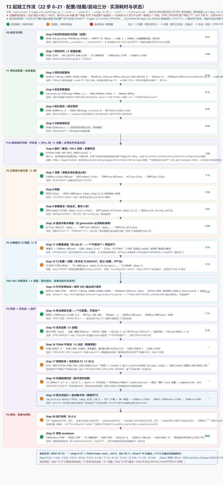

# T2 预约触发实施架构

Status: Active
Domain: TRIGGER
Canonical: `docs/trigger/t2/TRIGGER_T2_ARCHITECTURE.md`
Related: `docs/trigger/t2/TRIGGER_T2_TODO.md`, `docs/trigger/t2/TRIGGER_T2_TASK_PROGRESS.md`, `docs/trigger/t2/TRIGGER_T2_REVIEW.md`, `docs/arch/ARCH_T2_RESERVATION_ARCHITECTURE.md`, `docs/arch/ARCH_REALTIME_LOAD_MOUNTING_CONSTRAINTS.md`, `docs/trigger/t2/TRIGGER_T2_RUNTIME_CONSTRAINTS.md`
Last updated: 2026-10-17


> 口径（2026-10-19）：本文中"每位置 16 组"是**模型源口径**；台架判据按角色 **SWITCH_A 8 / SWITCH_B 2 / GATEWAY 2**（见 `TRIGGER_T2_TODO.md` 与登记项 `T2-GROUPCOUNT-01`）。
## 文档接口与范围

本文件定义 T2 当前主线的时间模型、owner 边界、不变量和验证语义；[TODO](TRIGGER_T2_TODO.md) 是任务状态唯一落点；[Task Progress](TRIGGER_T2_TASK_PROGRESS.md) 记录实现与证据。

## 台架起链流程图（节点 / 期望反馈）



上图的耗时与状态是绘制时快照；当前可执行流程与逐步实测由 `tools/sync_trigger/t2_workflow.py` 维护，并写入数据驱动视图 `T2_FLOW.html`。流程的判据自顶向下：**验收**（`p3_hardware_acceptance.py t2`：四板挂载、workflow 无失败步骤、参考板 `published_mask` 覆盖全部位置）← **发布**（`POSition?` 的 `tx_publish_count`）← **预览存在**（游标有效时计数尚未越过阈值；越过阈值的位置 Core0 不再生成预览）← **T2 服务被调用**（`T2?` 的 `segment_max_cycles`，[42..44]）← **SYNC_TRIGGER 相位运行且未隔离**（`SYSTem:TDMA:SCHEDule?` 中相位 7 的 run 计数增长、`quarantined_mask` 无位 6；超出 `PROJECT_CORE1_PHASE_SYNC_TRIGGER_WCET_CYCLES` 即被隔离）← **参考游标有效**（`T2:CURSor?`；粘性故障现场在其末尾 7 字段）← 各停机态前置。排查时按此顺序自下而上定位，**先验证下层反馈，再看上层计数**。

**更正（2026-10-12，`T2-PROGRESS-20261012-001`）**：此前写的「相位 6 窗口小于 WCET、需优先级源 active 才能运行」来自 `SCHEDule?` 步长与相位号的误读，不成立；SYNC_TRIGGER 是相位 7，`close_cycle` 为静态值，与优先级源无关。

## 静态配置 / 动态配置的分野与顺序规则

起链必须严格分成两段；把"配置"混到"运行"之后会静默失败。**三个语义必须分清**：

1. **配置**：写入参数或表（环剖面、标定重放、位置表、动作表、模板、计数器、路径延时交接）。全部是停机态写入。
2. **挂载（arm）**：只把模块置为"已武装/可用"，本身不产生输出。包括 `T2:CONFigure` + `T2:MOUNT`（2026-10-19 起命令名已由历史命名 `STARt` 改为 `MOUNT`，与语义一致）、`VDC:FEEDback:SESSion` + `VDC:OUTPut:RUN`（提交运行请求）、`PRIORity:SYNC/MATCH/FOLLow`（提交优先级类）、`SYNC:VDC:DPLL:ProVisional`（路径延时交接）。
3. **启动（动态）**：真正让运行时开始产出的那次使能——`RING:START`（环数据使能）与 `LOAD:MASK` 位 6（`APP_REALTIME_LOAD_SYNC_TRIGGER`，同步触发相位使能 ⇒ T2 开始发布）。**"T2 的启动"只能用掩码位 6 表达**：环一旦 `enabled`/`adapter_started`，`T2:MOUNT`、`SESSion`、`OUTPut:RUN`、`PRIORity:*` 等停机态写入一律被拒（`tdma_service.c:1033-1035` 与 `1079-1081`，reject 115/135），因此挂载必须在起环前完成，而动态启动由不受该限制的掩码位承担。

**静态配置（`RING:START` 之前，环必须停止）**：凡走停机态元数据路径（`tdma_service_run_stopped_maintenance` / `update_stopped_metadata`）的写入都属此类，它们**会推进环配置序号**，因此顺序由绑定新鲜度决定：

- 环：`CALibration:TOPology:PROBe` + `TDMA:OPMode:STAGe/APPLy`、`RING:GEOMetry`、`RING:TOPology`、`RING:DIAGnostic 1`。
- 位置表：`GRID:CONFigure` → `DEPloyment:STAGe/ACTivate` → `ACTion:INSTall` / `TEMPLate:INSTall` → `COUNter:LOAD`。
- **T2 配置**：`T2:CONFigure` 的前置是 diag 91/92/93——网格已配置、部署 `active.valid`、动作表/模板 `installed && resources_loaded && binding_current`（`scpi_trigger_t2_runtime_commands.inc:74-89`）。`binding_current()` 要求环停止且配置序号未变，因此 **T2 配置必须早于**后续任何停机态写入（会话/`OUTPut:RUN`/优先级）。
- VDC 时基：`OUTPut:TIMing`、`FEEDback:SESSion {generation}`、`OUTPut:RUN period,high,duration`（`duration=0` 表示连续运行；1..20000 是有限调试运行）。
- 临时训练：`SYNC:VDC:DPLL:ProVisional 1` 要求环停止、staged 配置 enabled、标定阶段 complete 且 node_count/topology/profile/schedule CRC 与 staged 逐项相等，且**反馈会话必须已关闭**（`vdc_dpll_manager.c:4363`）——故它排在开会话之前。
- 优先级类：`PRIORity:SYNC`/`MATCH`/`FOLLow`/`FOLLow:PHASe`。`FOLLow` 要求活跃会话、generation 匹配、`s_priority_match_request_session == session`，并要 boundary 请求计数为偶数；其查询页 `FOLLow?` 在通道 active 时拒答，**判据只能用 `FOLLow:STATus?`**。
- 时基掩码：`LOAD:MASK 91`（位 6 = `APP_REALTIME_LOAD_SYNC_TRIGGER`）属静态配置，在起环前设置。

**静态提交、动态生效**：`T2:MOUNT`、`VDC:OUTPut:RUN`、`PRIORity:* 1`、`LOAD:MASK 91`、`ProVisional 1` 只提交请求或使能；实际产出发生在运行期（VDC 输出服务的起环前 outcome 是 `RING_WAIT`/`MODEL_UNAVAILABLE`/`IDENTITY_WAIT`，属正常等待而非故障）。

**动态动作（只能在运行期）**：`RING:START`（数据使能）、`SOURce:STARt`、`CALibration:ORIGin:TRIAL`、采样与验收判据、停机 teardown。**T2 的发布建立在这三者之上**：TDMA 环在跑（`enabled && adapter_started`，`ring_seq` 递增）+ VDC 输出在产块 + 计数器在走；`T2:MOUNT` 只是挂载，服务在同步触发相位里被调用，条件不满足即早退（`T2?` 的 `segment_max_cycles` 保持 0）。

**计数时序约束**：参考游标必须在计数到达首个阈值之前有效。台架上推进计数的是 PWM 源（`TRIGger:REServation:SOURce:STARt`），因此源只能在游标有效之后启动；计数先于游标越过阈值的位置不会再有预览，该轮无法发布。转台模型仍须在环启动前武装（其脉冲调度在环接管调度器后会被拒，fault 3）。

之前完成的 COUNTER、SWITCH、GATEWAY、动作表安装和一次性 action ARM 只是动作基础。当前主线是同步 VDC 与 1 kHz 时间片构成的准确时间系统：VDC 基准推进共同时间，NO1 发布预测位置，从板按本地时间片执行动作。本文不把旧的 STOP 诊断执行切片描述成完整 T2。

本文仍是实施草案。位置描述符 wire、资源配额、同步质量门限和产品时限尚未冻结；跨域契约待实现和独立复核后登记。

## T2-SEMANTICS：已确认的语义口径（2026-10-10）

以下六条由用户在 [T2 评审](TRIGGER_T2_REVIEW.md) 中确认，是本文其余章节的上位口径；章节内容与之冲突时以本节为准。它们是设计口径，尚未实现的部分见 TODO，不登记为契约。

| # | 口径 |
|---|---|
| K-1 | 转台到达位置后，**先切换通道（SWITCH），再触发网分测试（GATEWAY TRIG）**。多板模式下，网分 READY 只做异步的时间片踩踏校验，不是许可门；单板模式可另行规定。 |
| K-2 | **DCO 是底层时间源，无法冻结，始终正常更新**。FREEZE 只冻结位置预测（`position_q` 与 prediction version）。单个动作的 deadline 被硬件接受后不再追改；尚未装填的动作在装填前按最新 DCO 重新解算，解算放在网分采样期间。 |
| K-3 | **调试阶段：T2 接受任何可达的锁态，只记录、不阻断**（2026-10-14 用户裁定，**取代**原「VDC 进入 LOCKED 并发布之后 T2 才有输出」）。T2 消费 VDC 的锁定判定并把它记入快照与证据，但**不得因锁态拒绝、阻塞或跳过** deadline 的生成与装填——本阶段先把功能跑通、能成功，规则细化阶段再收紧。正式输出门禁（含非发布态拒绝）延后为独立任务，不阻塞 T2 主线。 |
| K-4 | 扫描由起始、终止和 **STEP** 定义，**角度单位为度，分辨率 0.001°**（实现使用整数毫度）；**每个 STEP 位置都执行完整触发**。 |
| K-5 | **T2 位置一帧发完，不分片**，作为一等席负载；DPLL/VDC 同步发布走特等席。**落地方式（2026-10-11 确认）**：T2 使用独立一等邮箱，与特等轮流占用 origin 快速路径的发布机会（当前比例 1:1，编译期常量）；一等邮箱是完整 process image，保留 VDC 核心字段与 ACK，既有 RefMem 区直接承载 T2 紧缩记录，**不再压缩同帧 VDC 字段占位来腾空间**。 |
**K-5 增补（2026-10-13）**：一等席载荷仍受**两板 effective schedule CRC 一致性门**约束——
CRC 不一致时**必须拒绝帧**，**禁止运行态单板私自降级**（见 `docs/arch/HAOFV_ARCHITECTURE.md` 的 TDMA
operating profile 与 schedule CRC 条款）；本文约束层见
`docs/trigger/t2/TRIGGER_T2_RUNTIME_CONSTRAINTS.md`。

| K-6 | **每个位置运行多组序列与采样**（当前为 16 组）。16 组在位置开始前全部预装；执行端使用**包含两组的滑动窗口**：一组执行完，即用最新 DCO 解算并推入下一组，始终两组在途。 |

### 2026-10-12 增补（长扫描口径）

K-4 的"逐 STEP 位置"在 0..360°@1°（361 位置）下的**落地口径**，用户在 2026-10-12 确认；实现符号见 `components/sync_trigger/inc/trigger_turntable_predictor.h`，状态见 TODO：

| # | 口径 |
|---|---|
| K-7 | **只预测下一到两个位置**（滚动窗口，`TRIGGER_TURNTABLE_WINDOW_MAX = 2`）。长扫描的 361 个位置**不进入常驻状态**，常驻的是 1～2 个在途位置。 |
| K-8 | **位置目标是扫描绝对的**：目标计数由扫描原点 + 角度派生（`trigger_turntable_window_enter()` 用 `origin_count`），与"该位置何时进入窗口"无关。 |
| K-9 | **行程 = [起始−5°, 终止+5°]**（`pre_roll_mdeg`/`post_roll_mdeg`）：预行程使**位置 0 可被预测**（此前无观测、无速率），后行程使**终止位置可验证**；两段 roll 必须是整数脉冲且 ≥ 1 个 STEP。位置网格仍为 起始..终止 by STEP。 |
| K-10 | **冻结余量按位置周期均匀**：阈值 = 目标 − 一个 STEP 的 `threshold_per_mille`（当前 950/1000），因此扫描中每个位置被冻结的提前量一致。 |
| K-11 | **超出 2 个位置的预测一律视为不准确**（速率是单样本估计 `pulses_per_sync_q16`，误差随跨度增长）：窗口外不产生 target/threshold/FREEZE 任何对外事实；窗口内位置若速率不可用则 fail-closed 并计数（`window_rate_stale_count`）。 |
| K-12 | **线格式不变**：10 B 单帧（tag+4 bit `position_id`、16 bit 版本、32 bit `target_ms_index`、24 bit fine slice）。绝对位置由 `target_ms_index` + 扫描参数确定，`position_id` 只作在途实例编号，因此 361 位置无需加宽 id、无需两级身份。 |

窗口自身的健全性事实（**已在 `TRIGger:REServation:T2?` 末尾读回**，2026-10-12；台架判据 `announced == entered` 且 `overwrote_unannounced == 0`）：`window_entered_count` / `window_announced_count`（每个进入的位置是否恰好宣告一次）/ `window_overwrote_unannounced_count`（是否出现"未宣告即被覆盖"）/ `window_late_entry_count` / `window_recomputed_count`。

## T2-SCOPE：主线和边界

T2 将转台位置预测映射到共享 VDC 时间轴。NO1 使用 COUNTER 观察转台输入，其他板卡使用同一 VDC 基准在各自本地执行预先定义的动作。板卡角色由 deployment 绑定到 UID、TDMA slot 和本地 IO，不能由 NO 编号或编译期板号推断。

运行角色为 `COUNTER / SWITCH / GATEWAY`。首轮台架映射为：NO1 COUNTER 使用 IN1；NO2 SWITCH_A 使用 OUT1–OUT3；NO3 GATEWAY 使用 OUT4 并从 IN1 接收 READY；NO4 SWITCH_B 使用 OUT1。相同 OUT 编号属于不同板卡的本地命名空间。

细分脉冲只用于验证细分能力、边沿完整性和示波器测量方法。T2 运行时依据 1 kHz VDC 基准同步脉冲，每次基准同步更新一次本地时间片坐标。细分位置可以作为逻辑索引的一部分，但物理细分脉冲不是运行时钟源。

硬件槽位、PIO 程序、IO 路由、动作模板和循环表在 TDMA START 前完成装载和读回。TDMA RUN 后不改变业务槽位、PIO 程序、IO 路由或动作模板；运行期只接收预测位置索引、更新本地时间片标记并执行既有动作。

## T2-PAYLOAD：配置、实时位置和诊断的分层分配

T2 的载荷分为启动前配置事务、运行期实时位置和冻结后的诊断回传三层。三层使用不同的 owner、生命周期和失败策略，不能把本地预测结构直接当作线上载荷。

### 启动前配置事务

VDC 启动前通过现有 `CONFIG_CONTROL` / `NODE_LOAD_STAGE` 控制通道完成一次配置事务。事务允许跨多个 TDMA 物理帧，但逻辑上只有一次 `BEGIN → DATA → ACK → COMMIT`。配置内容包括 run/grid/count epoch、deployment/template/PIO/IO 绑定、位置到动作映射、source/target、阈值、有效窗口、nonce 和回退策略。

必需节点返回 nonce、generation、完成/未完成掩码和错误原因后，主站执行 STOP→ARM，原子激活 active 配置，再启动 VDC。RUN 中只读 active 配置，禁止热加载 PIO、模板或 IO route。

### 运行期实时载荷

运行期使用 `TDMA_PAYLOAD_CLASS_CYCLIC_PROCESS_IMAGE` 的 node mailbox，T2 位置作为**一等席负载**（K-5）。一等邮箱是完整 process image：保留 VDC 核心字段、ACK 与 control，既有 RefMem 区直接承载 T2 紧缩记录（`TRIGGER_POSITION_SLICE_WIRE_SIZE` 恰填该区，无需压缩字段占位）；CRC 继续由原 owner 管理。一等席按发布机会与特等轮流上车（TDMA-SEAT-01），不借用同帧的 VDC 字段空间。

T2 的业务载荷只有一个 `position_q`：

```text
position_q = target_ms_index * subdivisions + target_fine_slice_index
```

一个位置记录必须**在一帧内完整送达**（K-5），不分片、不跨帧重组。完整 `trigger_position_descriptor_t` 只保留在 NO1 和从板本地预测/诊断镜像中，不作为线上载荷。位置身份必须由显式 T2 message subtype 或紧凑状态字段携带，不能依靠 q 数值或传输顺序推断。外层 source/target、transport sequence、generation 和 admission epoch 只负责路由、去重和运行代隔离。

达到外部阈值后，NO1 发出该位置的 FREEZE/版本索引，停止新的 `position_q` 发送。从板停止对该位置的**位置预测**更新，选择本地最新有效版本并准备已激活动作模板。FREEZE 不冻结 DCO 时间映射（K-2）；FREEZE 记录与 PREVIEW 使用同一套运行代身份校验。

**FREEZE 是开始冻结，全部目标收到后才是冻结完成**（2026-10-10 用户确认，`3ddeb258`）：
- 从板收到某位置的 FREEZE 即完成本板冻结，并把"run_id 低 4 位 + 已冻结位置掩码"作为状态写入其每个镜像的 control 字节（`TDMA_PROCESS_IMAGE_CONTROL_OPCODE_T2_FROZEN`）；一次环回即可把状态带回 NO1。
- NO1 对未完成位置按间隔重发同版本 FREEZE（`T2_FREEZE_RESEND_SLICES`），直到 `target_mask` 内全部从板报告该位置已冻结，置 `freeze_complete_mask`；位置窗口过期仍未完成则置 `freeze_abandoned_mask` 并停止重发。从板对重复 FREEZE 只接受第一次。
- 诊断：`TRIGger:REServation:T2?` 末尾的 `freeze_complete_mask`、`freeze_abandoned_mask`、`freeze_resend_count`，以及 2026-10-11 追加的 `freeze_abandoned_count`（放弃完成的次数）与 `late_arrival_count`（**迟到到达**：记录格式与寻址都对，但抵达时承诺窗口已关闭——它仍计入 `descriptor_reject_count`，只是不再与身份/网格/部署等 10 种原因混在一起；目标溢出导致的"无窗口"不算迟到），以及迟到的**量级** `late_last_current_ms`（到达时消费侧粗序号）与 `late_last_expiry_sync`（被错过的窗口），二者之差即迟到量；并**逐位置**公开承诺本身（`descriptors[i].target_ms_index` 低字与 `descriptors[i].expiry_sync`）——没有承诺作参照，迟到计数不构成证据。**注意**：整机驱动下原点持续重解算、窗口被不断延长，"放弃完成"分支在那里不可达；该分支改由 `tests/python/test_trigger_t2_freeze_abandon.py` 以**抽取式 harness** 直接驱动（放弃、饱和、重发、节奏、确认、暂存被拒六种情形，并有负测证明断言有效，见 `TDMA-PROGRESS-20261011-033`）。**FREEZE 完成必须只等"同伴"（2026-10-11 修复）。** 冻结确认 `distributed_refmem_position_freeze_acked()` 是**全有或全无**：`opcode = T2_FROZEN | (run_id & 0x0F)`，掩码内**任一**槽位报的 opcode 不是本 run 就整体返回 0。而确认路径**只能从"收到的镜像"填充槽位**，所以一旦 `target_mask` 含**位置来源槽位自身**（`source_slot`），该位永远不可能被确认 → 每个位置都保持"未完成" → 原点按 `T2_FREEZE_RESEND_SLICES` 一直重发到窗口关闭。现策略：原点**只等同伴**（`peers = target_mask & ~(1u << source_slot)`），自身位被忽略并置标志 `freeze_ack_own_in_mask`；**无同伴**（单板台架）视为按构造完成，不产生任何重发。主机侧 `tools/sync_trigger/t2_enable.py` 原先下发 `0x0F`（含槽 0）已改为按 `--nodes` 推导同伴掩码（4 板 → `0x0E`）。判据：一旦 `freeze_ack_own_in_mask == 1`，此前观察到的"重发很多"就是这条配置错误，而不是链路丢失。

另附 `freeze_abandoned_count`（饱和计数）：位置窗口过期仍未完成会置位掩码，但掩码按位置保存、下一次 run 会清零，**只有计数能回答"发生过多少次"**。

### 位置 TX：最新值表 + 定周期取数（2026-10-17 冻结口径）

位置记录的发送不是“生产者递交、被拒后重试”，而是**生产者只写最新值、发射端自己按周期取**：

- **最新值表**：每个在途位置一格（`DISTRIBUTED_REFMEM_POSITION_PENDING_SLOTS = 3`，与 `TRIGGER_T2_RUNTIME_POSITION_COUNT` 同值）。生产者（Core0 解算）每次解算都可写入，**永不因背压失败**；写已有未发值即**覆盖**并计 `tx_coalesced_count`（合并，不是丢弃）。等待中的 FREEZE 不被后到的 PREVIEW 覆盖（FREEZE 优先）。
- **发射端自己取**：`distributed_refmem_position_tx_prepare()` 只有在**一等席空闲**（`tdma_service_first_class_free()`）时才从表里取值，因此递交**按构造不可能被拒**（`stage_refused_count` 恒 0）；取数受 `T_drain` 定时约束（PREVIEW 受约束，FREEZE 不受约束），一次最多取一条。
- **一条记录带两个位置**：取当前条时，把表里下一位的最新目标写进同一 16 B 切片的 `[10..15]`（`next_position_id`/`next_target_ms_index`），从板因此无需第二次上车即可缓存下一位目标。
- **为何改**：单深度席 + 生产者每轮“递交/被拒”会把 `stage_refused` 变成“轮次忙等计数”（实测 1.07–1.50 次/条），且拒绝率随公告簇发在 6.6%–33.4% 之间漂移，无法作为判据。改为拉模型后：生产端只决定“最新值是什么”，发射端决定“何时发”。
- **安装参数（STOP 态或运行态写入、掉电回默认）**：`TRIGger:RESERVation:T2:DRAIN <ms>` / `DRAIN?`（默认 6 ms，上限 1000，0 = 不限速）；`TRIGger:RESERVation:T2:ANNOUNCE <tol_ms>,<min_ms>,<global_ms>` / `ANNOUNCE?`（默认 4/10/6；**0 表示该闸门不抑制**，越界仍拒绝且不改已安装值）。三者都进 `TRIGger:RESERVation:T2?` 相关页与 `SYSTem:REFMEM:SYNC:FLIGHT:POSition?` 的 `tx_coalesced_count`。
- **台架判据（2026-10-17 全 361 位置实测）**：`SEAT refused 0`、`tx_reject 0`、`tx_coalesced_count 671 > 0`、发送速率贴住 `T_drain` 上限（6 ms ⇒ 171/s）、四板 `361/361/361/361`、`late/expired/no_plan/conflict/backend` 全 0、`decode_reject 0`。**反例**：`T_drain=50 ms` 时 SWITCH_A/SWITCH_B 各出现 28/29 次 LATE ⇒ 50 ms 超出从板流水线预算，6 ms 才是安全区。


冻结后允许从板通过独立的低优先级 T2 diagnostic message class 回传一至两帧压缩诊断。第一帧报告 position、采用版本、版本年龄、q 有效性、动作准备状态和 READY 重叠状态；第二帧只在缺版本、旧代、CRC、时间片冲突或 READY 异常时发送，报告原因和残差摘要。诊断不能覆盖 VDC、ACK 或已排队的 VDC image。

`tdma_flight_fifo` 的通用双槽发布/获取/释放能力继续保留，供后续 TDMA 流式 OTA、配置数据和可靠控制使用。它不属于 T2 业务语义；T2 不修改已经进入 FIFO 的 VDC image，也不使用排队帧补写 T2。

### T2 完成与误差事实（载体声明，2026-10-13）

按顶层对 T2/Trigger 的上向事实要求（`docs/arch/HAOFV_ARCHITECTURE.md` 的「基础件向上收敛表」T2 行），
T2 对外必须提供：`T_fire_target_vdc`（预约目标）、reservation generation、READY mask、fence、
**`T2_actual_local`**（实际边沿的**硬件 latch**）、**`T2_actual_vdc`** 与 **`T2_error`**（= actual − target）。

载体分配：

- **本文已定义部分**：位置（`position_q`）、FREEZE/版本与其完成掩码、诊断回传。
- **归属预约闭环部分**（按顶层收敛顺序「最后开放预约执行」）：`T_fire_target_vdc`、预约代际、
  READY mask、fence、`T2_actual_local/vdc` 与 `T2_error` 的**载体与字段定义**；其 canonical 为
  `docs/arch/ARCH_T2_RESERVATION_ARCHITECTURE.md`，本文不重复定义。
- **奠基约束**：`T2_actual_local` 只能由 **PIO/DMA/IRQ 硬件 latch** 产生，**不得用 CPU 读取或软件完成时刻充填**；
  `T2_error` 计算必须遵守回绕安全写法，不得把无符号回绕差当作相位误差。

## T2-TIME：共同时间坐标

### 1 kHz 基准和本地 cursor

每个运行代维护：

| 状态 | 含义 | 来源 |
|---|---|---|
| `run_id / sync_epoch` | 当前运行代和计数时间域 | TDMA/VDC 运行身份 |
| `pulse_index` | 下一共同 grid coarse 周期的绝对索引 | 当前 TIMER1 经本板 committed DCO 投影到共同 anchor 后派生 |
| `fine_slice_index` | 当前基准周期内的逻辑细分位置 | 本板 grid/model 解算 |
| `action_cursor` | 本板当前检查的动作模板位置 | 由上述状态派生 |

`action_cursor` 是本地状态，不是主站逐动作命令。从板接收 VDC 同步信息后，
沿用既有 committed DCO 与 TIMER1 在本地产生连续时间轴；T2 读取同一模型，
将当前本地时间投影到共同 VDC 坐标，再相对 `anchor_vdc_ns` 计算 coarse/fine q。
接收观察的 `vdc_status.sync_seq` 与每个本地毫秒格不是同一种序号；接收观察
未更新时，本地网格仍推进。T2 不逐格占用 TDMA，也不要求物理细分诊断输出开启。

本地 `sample_seq` 只标记 coarse 位置推进，跨板不能直接比较。软件 service 可以
跨过多个本地格；这不等于 VDC 同步丢失。session、ring、slot、schedule、role 或
clock 身份失配，以及本地时间回退必须显式失效，不能补发越过的动作或重复执行。
当前 TIMER1 必须处于所用模型的有效期内，不把旧接收时间戳套进较新的模型。

本地网格分辨率由 grid 几何决定；已有细分能力覆盖本轮 500 ns 调试配置（测量快照
见 Task Progress 的细分验证条目）。T2 提前按位置索引解算本板硬件 deadline，
由预装 PIO 执行动作；软件轮询频率不决定硬件细分分辨率。映射有效仅表示本地
坐标与身份有效，完整动作精度仍由位置实例、硬件执行和外部同步采样共同验证。

### 位置索引、q 和相对偏移

绝对位置使用：

```text
position = (ms_index, fine_slice_index)
```

该位置可以在本地编码为绝对 grid ordinal `q`，但 q 不是 wire 上必须传输的本地 TIMER1 deadline。

- **绝对 q**：共同网格中的绝对时间片位置。
- **delta_q**：相对预测位置的动作偏移，属于静态动作模板或 profile。
- **本地 action cursor**：从板随 VDC 同步推进的执行游标，不跨板传输。

网络描述符的业务内容是位置索引，不是纳秒时间、本地 TIMER1 tick 或主站计算的每板 deadline。身份字段只用于防旧版本复活。

### grid 和细分验证

grid 保存 `epoch`、`generation`、共同 anchor、基准周期和逻辑细分数。细分输出属于独立诊断路径，不要求每个逻辑细分产生物理脉冲、IRQ、DMA 或软件 tick。

物理细分验证必须按对应索引比对边沿、保留末格空白并保存示波器原始数据。通过细分验证不等于获得 live cursor、共同 anchor 认证或业务动作完成资格。

## T2-PREDICT：NO1 预测与描述符

NO1 的预测计算不在 VDC 发布路径内。Core1 在每个 VDC 基准同步点只取得有界计数观察并记录阈值事实；Core0 使用最近完成的计数窗口异步计算预约位置时间片：

1. Core1 读取 COUNTER 的最新计数观察并把观察交给 Core0；
2. Core0 从最新完成的窗口维护周期/速度估计和 prediction version；
3. Core0 更新同一个预约位置时间片并提前发布最新有效版本；
4. 距离阈值越近，Core0 缩短窗口计算间隔，以降低样本年龄和速度变化带来的预测误差；
5. Core1 只检查是否跨过外部配置阈值，并提交冻结版本 index 的意图。

预测结果不会因为没有新窗口而伪造新版本；没有新结果时继续使用上一份完整结果。阈值广播只标记应采用的 prediction version，不发送完整预测镜像，也不触发槽位热加载。各板本地保留最新有效镜像和两份旧镜像用于诊断对比。

### 角度扫描与 STEP 位置

扫描按 K-4 由起始角度、终止角度和 STEP 定义，单位为度，分辨率 0.001°。实现中角度一律使用整数毫度：

```text
position_angle_mdeg(k) = start_mdeg + k × step_mdeg,  k = 0 … N−1
N = (terminal_mdeg − start_mdeg) / step_mdeg + 1
step_pulses = step_mdeg × pulses_per_degree / 1000
base_angle_mdeg = start_mdeg − pre_roll_mdeg
target_count(k) = origin_count + ceil((position_angle_mdeg(k) − base_angle_mdeg) × pulses_per_degree / 1000)
```

配置时以整数运算校验，不满足即在 STOP 阶段拒绝（fail-closed，运行期不取整、不兜底）：`(terminal − start)` 能被 STEP 整除；`step_pulses` 为正整数；累计计数不溢出；STEP 满足下文的时间下限。每个 STEP 位置都是独立的预测目标，各有位置序号、预测目标计数和 prediction version，并执行完整触发（K-1、K-6）。

**阈值与 lead（2026-10-11 口径）**：lead 取「一步的比例」，不再取「距 origin 的比例」：

```text
lead_pulses = ceil(step_pulses × (1000 − threshold_per_mille) / 1000)
threshold_count(k) = target_count(k) − lead_pulses
```

按距 origin 的比例在长扫描上会让远端位置的 lead 随距离线性膨胀，使数十个位置同时在途；一步比例把在途位置数限制为常数（`threshold_per_mille` 为 500 时 lead 为半步）。在途位置数上界仍须与「位置身份与在途容量」的槽位数、FREEZE 重发节奏和环回确认一起核算。

位置数由扫描参数决定，不再固定为起始/零位/终止三个。运行期只为有界个在途位置保留状态，其余按序号滚动生成；位置序号须能表示完整扫描并防回绕。

STEP 的下限由时间推出：相邻位置的时间间隔（`step_mdeg / 转速`）必须大于一个位置内全部序列的跨度（见 T2-ACTION）加余量，否则下一位置会踩到上一位置。该下限在配置时按**声明转速**校验，运行中仍由 READY 踩踏校验和位置忙故障兜底。声明转速只用于该配置校验与模拟源频率换算，不进入运行期预测；运行期速率仍由 predictor 自测。

**零位（2026-10-11 口径）**：零位不再是独立的预测目标。`zero_angle_mdeg` 只作配置一致性检查——零位必须落在 STEP 网格上（`start_mdeg` 为 0 且 STEP 整除时天然成立），否则 STOP 拒绝。内部位置 index 从 0 起（`index = k`），线上与 SCPI 暴露的 position id 保持 1 起（`position_id = index + 1`）：`position_id == 0` 在全链路都是「无效/无」哨兵，且 id 落在 tag 字节低位为 0 时会退化到冻结 opcode 家族，禁止使用。

参考实现：`feature/node-sequence-reservation-trigger` 分支已有 `CONFigure:ANGLe:SWEEp start,stop,step,speed`、`CONFigure:ANGLe:INPut INn,pulses_per_degree` 及读回命令；其 SCPI 解析/校验、READ 格式与整数格点数学可复用，Core0 浮点判整须改为整数毫度运算。该分支「READY 授权下一步」「同一时刻只允许一个位置在途」的推进模型与 K-1/K-6 冲突，不得照搬（复用边界见 `docs/trigger/t2/TRIGGER_T2_STEP_REVIEW.md`）。

### 位置身份与在途容量

位置数由扫描参数派生后，身份与容量必须先同时满足下列约束，未冻结前不得宣称支持完整扫描：

- 紧凑记录的 position id 受 tag 字节位数限制（有效范围见 `trigger_position_slice.h` 的 `trigger_position_slice_valid()`），FREEZE latch 槽数见 `TRIGGER_POSITION_FREEZE_LATCH_IDS`，冻结完成确认只占控制字节里的 `TDMA_PROCESS_IMAGE_CONTROL_SEQ8_OFFSET` 一处；三者容量均远小于长扫描的位置数。
- FREEZE 完成确认必须能覆盖全部在途目标，不允许只覆盖前几个序号。
- descriptor 的 FREEZE 校验上限（`trigger_position_descriptor.h`）须与新的身份口径一致。
- 运行期只为有界槽位保留状态。**2026-10-12 已定稿（K-7、K-12）**：本轮只预测下一到两个位置（窗口上限 2），位置数（0..360°@1° 为 361）**不进入常驻状态**；线上 `position_id` **保持 4 bit 作在途实例编号、不加宽**，绝对位置由 32 bit `target_ms_index` 与扫描参数确定，故「加宽 id / 槽位+滚动代次两级身份」方案**不再需要**；冻结完成确认沿用 32 bit 掩码（覆盖在途槽位即足够），**不需要** 361 位分级确认。RAM 预算以实测尺寸为准，不得按「一位一槽」线性放大。剩余未决项**只剩**与 TDMA 一等席布局的联审登记（见下条），口径细节见 TODO 的「2026-10-12 定稿」节。
- 决定落地后，紧凑记录的跨域契约须在 `docs/check/DOCS_REGISTRY.md` 登记并经独立交叉审核（C11）；登记完成前，当前实现不得写成冻结契约。

### 模拟源与配置参数

- `pulses_per_degree` 必须作为 T2 配置参数下发，并与模拟源共用同一个值，禁止两侧各自写死。
- 模拟源以转速与 ppd 为输入换算频率：`frequency_hz = speed_mdeg_per_s × pulses_per_degree / 1000`；换算须为整数，或由配置期显式定义取整并读回实际频率（源的输出频率是量化后的实测值，不是声明值）。
- 脉宽必须可配置，不使用固定占空比代替。
- 口径已定（2026-10-13，用户裁定）：台架以 **OUT4→IN1 硬件回环模拟**转台输入（回环已接好），接实际转台时由转台直接驱动 **IN1**；两条源路径保留——`TRIGger:REServation:SOURce:*` 的 OUT4 硬件 PWM 源用于**隔离验收**，`CONFigure:MODEl:TURNtable:*` 的加减速模型源在需要**加减速真实性**时使用（参 `TRIGGER_T2_STEP_REVIEW` 的 D-7）；正式冻结仍待 T2-AUDIT-03 的五项契约登记。

### 起始热身区、零位格点与终止校验区

转台运行配置必须显式包含 `start_position`、`terminal_position`、`step`（角度扫描步长）、`pre_roll_angle` 和 `post_roll_angle`，以及仅用于网格一致性检查的 `zero_position`。当前台架配置将预运行区和终止校验区都设为 5°（调试快照，非产品额定值）：转台从 `start_position - pre_roll_angle` 开始，在 `terminal_position + post_roll_angle` 停止。

预运行区用于建立计数 epoch、估计脉冲周期/速度、检查方向和生成起始角度预测。起始角度本身也是预测目标，必须生成 `start_position_id`、预测目标计数和 prediction version；预运行区的预测不能被误报为起始角度或零位的实际到达。零位落在 STEP 网格上时是普通位置，由扫描派生自己的位置序号、预测目标计数和绝对时间片；不在网格上则 STOP 拒绝（见「角度扫描与 STEP 位置」）。不能用预运行区的区间中心或主机到达时间替代任何位置的预测。

终止角度同样是预测目标，必须生成独立的 `terminal_position_id`、预测目标计数和 prediction version。终止位置动作按该预测计数对应的时间片执行；终止位置之后的 post-roll 区用于继续更新/校验终止预测，确认最后位置实际边沿、检查迟到/重复/缺失和验证没有越过终点的额外动作。post-roll 的停止事件不能反向改变已执行的终止位置动作。

起始角度、各 STEP 位置和终止角度的验收至少保留：起点计数、预测目标计数、计数 epoch、prediction version、position ID、目标 coarse/fine index、实际输入边沿和实际动作边沿。精确位置输出的含义是动作绑定到确定的预测目标索引并按该索引执行；是否实际到位仍须由实际输入/动作边沿在声明容差内校验。预测时间区间或 READY 电平不能填充缺失的边沿证据。

NO1 通过 TDMA 分发单个版本化 `position_q`。预览记录的完整业务和预测字段保存在本地；线上只携带位置身份、`position_q` 和必要的紧凑版本/状态标记。`count_epoch`、`run_id/sync_epoch`、grid/deployment generation/CRC 和有效同步区间在启动前配置并在本地校验。阈值记录只携带 `position_id` 与 `prediction_version`，用于冻结已发布版本。业务语义仍只是时间片索引。

从板收到 `position_q` 后校验启动期身份和紧凑状态，使用本板 VDC model、grid 和 local cursor 绑定目标时间片，再展开本地动作模板。阈值版本 index 到达而对应最新本地结果未到时，从板使用本地最新有效预约位置时间片执行，并记录版本不一致；不能用主机消息到达时间或主站逐板 TIMER1 deadline 代替本地时间轴。

### 审查/完善记录（已下沉）

本节的对照结论与改动记录已按三件套分工下沉至 `docs/trigger/t2/TRIGGER_T2_TASK_PROGRESS.md`（证据唯一落点）；本文只保留稳定语义。

## T2-ACTION：静态模板与位置实例

动作表拆成两层。

### 静态循环动作模板

TDMA START 前装载并冻结：

- template ID、generation 和 CRC；
- 循环跨度；
- 动作 kind、业务 role 和本地 IO route；
- 相对预测位置的 offset；
- 占用、settle 和反馈检查窗口；
- SWITCH 编码或 GATEWAY 脉宽等参数。

模板是少量可循环复用的动作定义，不携带某一次转台目标的绝对位置。

### 运行时位置实例

位置提示到达后，从板本地生成：

- position ID、prediction version；
- target coarse/fine index；
- count epoch/target count；
- template ID 和 instance generation；
- 本板按模板展开后的各组动作时间片标记。

位置实例只标记本次动作在哪个时间片执行，不修改 PIO 程序和业务槽位。

### 位置内多组序列

按 K-6，每个位置运行多组序列与采样。组数取自 `node-sequence` 分支的权威定义：`TRIGGER_RESERVATION_ITEM_COUNT`（`trigger_reservation_config.h`），每项一项测量配置（`trigger_reservation_build_plan()`：`output_code = (i // 2) | (level << 2)`，即 SP8T 通道每两项一档、极化取项奇偶）。每组依次为“切换通道 → 触发网分 → READY 窗口”（K-1）。所有组都锚定在同一个位置 `q_P` 加模板偏移上：

```text
位置 P（q_P）:
  组 1: SWITCH(code_1) @ q_P + d_s1 -> TRIG_1 @ q_P + d_t1 -> READY 窗口_1
  组 2: SWITCH(code_2) @ q_P + d_s2 -> TRIG_2 @ q_P + d_t2 -> READY 窗口_2
  ...
  组 n: SWITCH(code_n) @ q_P + d_sn -> TRIG_n @ q_P + d_tn -> READY 窗口_n
```

- 多板模式下，组与组之间**不由 READY 推进**（K-1），只按模板中预先排好的偏移执行；因此网分响应时间的波动不会逐组累积。
- 组间隔按网分**最坏**响应时间加切换 settle 和余量排布；READY 窗口用于发现踩踏，不用于推迟下一组。
- 各板分工：SWITCH 板只执行各组的切换步，GATEWAY 板执行各组的触发与 READY 采集；各板共享同一个 `q_P`，偏移来自各自的模板。
- 一个位置的跨度约为 `n × 组间隔`，它决定 STEP 的时间下限（见 T2-PREDICT）。
- **时间参数是可配置的安装参数，不是编译参数**：每组的偏移住在它自己那行模板里（`delta_q`）与自己的 `argument` 里，安装发生在停机态（`TEMPLate:INSTall`），因此改组间隔/组码只需**重跑安装与采集**，**不需要重新烧录**。工装侧的统一入口是 `config/trigger/t2_sequence_profile.json`（角色组数、`group_period_slices`、`group_offset_slices`、逐组码、网分脉宽）与 `t2_workflow.py` 的 `--seq-*` 参数；优先级为 **命令行 > 环境变量 > profile 文件 > 内置默认**（内置默认是每角色 1 行，即序列落地前的行为）。扫组间隔用 `tools/sync_trigger/t2_sequence_sweep.py`（同一固件、多档周期，逐档只重跑安装+采集）。
- **实测约束（2026-10-16，短扫描）**：周期 10 ms 与 25 ms 两档下，从板每个位置只跑完第 0 组（`T2:ACTion?` 组打包字 `done=0b1`、`next=1`、`in_flight=0xF`），25 ms 档开始出现 `late`/`no_plan`。原因是**执行端是"观测到上一组完成才布防下一组"**，该往返在重载从板上大于组间隔；因此紧间隔需要的深度 ≥2 绝对 deadline 队列是**跨域前置**（SYNC_IO 域 `SYNC-SCHED-001`）。T2 侧已实现的“在途窗口”把下一组的**绝对 tick 与当前组一并解出**（`t2_deadline_plan_t.next_tick`），Core1 在完成当遍即可推进布防，去掉 Core0 解算往返；剩余的是执行端能否**提前持有**第二个 deadline。

### 预装与两组滑动窗口

- **预装**：一个位置的全部 n 组序列内容（通道编码、相对 `q_P` 的偏移、网分脉宽等）在位置开始前全部就位，属于静态模板或位置实例，RUN 中不热加载。
- **滑动窗口**：执行端同一时刻只持有两组已解算的绝对 deadline。第 k 组执行完后，网分进入测量；在这段测量时间内，Core0 用最新 DCO 解算第 k+2 组，Core1 在其到期前装填，窗口前移一格。装填前比较模型 token，不一致时使用新解算，赶不上则判为迟到并记录，不立即补发。
- **不追改**：某组 deadline 一旦被硬件接受，不再因 DCO 更新而修改（K-2）；DCO 继续正常更新，供窗口内尚未装填的组使用。
- **前提**：DCO 模型切换必须连续，不得在模型块边界产生相位跳变，否则同一位置内相邻两组之间会出现等于跳变量的间隔误差。连续性由 VDC 域证明。
- 执行端需要深度为 2 的 deadline 队列，每组保留独立的序号、回执与取消结果。

DCO 新鲜度评估见 [T2 评审](TRIGGER_T2_REVIEW.md) E-01：VDC LOCKED 时，即使整个位置沿用同一模型，偏移也只有 ns 量级；滑动窗口使每组模型年龄不超过约一个 Core1 整表周期。

### 动作解耦

动作不使用“下一动作”串行提交模型。每个动作只负责自己的时间片、输出和执行证据。顺序由模板中的相对 offset 和 settle 预算预先确定；动作到达自身时间片即执行；上一级时间分析通过静态 profile 约束下一级位置，不变成运行时等待或临界期软件补救。

**边界判定（2026-10-16，用户口径）**：`T2 只负责分发时间片；动作执行得到时间片之后，自行按照约定进行`。即：

- **分发侧（T2）**：每个位置只交出一个时间片（位置身份 + `q_P` + FREEZE + 该位置的绝对 deadline），并负责**约定**的安装与可读（本板角色的组序列表：每组 `argument` 与相对偏移 `delta_q`），以及位置级执行证据。**T2 不得逐组配速**：不按“上一组完成”去推下一组的布防，也不为每组做 Core0 解算。
- **动作侧（执行端）**：拿到时间片后**自行**按约定展开整条序列——第 `g` 组落在 `时间片 + (delta_q_g − delta_q_0)`，settle/READY 与逐组回执都由它自己掌握；相邻两组之间不得依赖任何一次 T2 服务往返。需要它具备**深度 ≥2 的绝对 deadline 队列**（`SYNC-SCHED-001`，SYNC_IO 域）。
- **四板并行、只对时间片负责（2026-10-16 用户口径）**：四块板**并行执行**，各自只对**位置时间片**负责。同一 `q_P` 分发到各板后，每板按本角色的约定独立展开自己的序列；**板间无先后、无逐组握手、无跨板等待**（组间不由 READY 推进，K-1），任何一块板的动作不构成另一块板推进的前提。T2 的分发只承载时间片与身份，板上执行证据各自上报、由位置级汇总判定。
- **过渡态**：在动作侧具备序列能力前，T2 侧保留一个**在途窗口**（`t2_deadline_plan_t.next_tick`：解本组时一并下发下一组的 tick，Core1 在完成当遍推进），它只是过渡实现——真板实测（周期 30/40/50/60 ms）显示"观测到完成再布防"在任何间隔下都停在每组 1 组，故这条过渡路径不作为长期方案，动作侧接受序列后即移除。

### 审查/完善记录（已下沉）

本节的对照结论与改动记录已按三件套分工下沉至 `docs/trigger/t2/TRIGGER_T2_TASK_PROGRESS.md`（证据唯一落点）；本文只保留稳定语义。

## T2-OFFSET：相对位置和调试默认值

以下 profile 可外部配置并读回：

- `switch_settle_offset_q`
- `gateway_trig_offset_q`
- `ready_check_offset_q`
- `ready_window_q`

按 K-1，到位后先切换、再触发：SWITCH 在预测到位位置或其后执行（`switch_settle_offset_q ≥ 0`），GATEWAY TRIG 在 SWITCH 加 settle 之后，READY 窗口在 TRIG 之后。多组序列下每组各有一套偏移。具体默认值待按网分最坏响应时间和开关 settle 重新标定。以上数值是调试快照、不是产品事实源；实现必须符号化、带 generation/profile CRC，并用示波器和设备响应时间校准。

## T2-READY：上一动作重叠校验

多板模式下（K-1），READY 只做异步的时间片踩踏校验：校验上一级动作的实际响应是否与计划时间片重叠。多组序列下，每组 READY 与该组的 TRIG 关联，踩踏判定逐组进行：

1. 记录上一级动作实例身份和计划窗口；
2. 在 profile 指定窗口内采集 READY；
3. 映射回共同时间坐标；
4. 检查早到、迟到、缺失、重复和相邻动作重叠；
5. 生成诊断和业务证据。

READY 不作为当前动作执行许可，不形成当前动作 fence，不替代 PIO 执行回执，也不自动表示 VNA 完成。没有硬件时间戳时，只报告状态观察或不确定区间。

## T2-START：启动和运行生命周期

### TDMA START 前

deployment、PIO/SM/FIFO/GPIO persona、静态模板（含每位置全部组序列）、角度扫描参数（起始、终止、STEP）、grid 几何和 profile 完成装载、CRC/generation 读回，并设置新的 VDC session。STOP 配置不能要求只有 RUN 后才产生的同步事件或锁定模型；本地 cursor 和预测状态在 RUN 中按真实事件建立，不能由静态配置读回授予动作资格。

### TDMA RUN 中

- VDC 每个 1 kHz 基准同步更新一次 local cursor；**锁态只记录不阻断**（K-3，2026-10-14 裁定）：T2 读 VDC 锁定判定并记入快照与证据，未 LOCKED／未发布时**同样**生成并装填 deadline；
- NO1 在每次同步取得计数观察，Core0 按完成窗口异步更新预测；阈值跨越时通过 TDMA 一等席单帧广播一次位置提示；
- 从板解析位置记录并标记本地各组动作时间片；
- 执行端按两组滑动窗口装填，本地硬件到达时间片后执行动作；DCO 更新在网分采样期间作用于尚未装填的组；
- READY 只做上一动作的重叠校验；
- 不通过 STOP/START 重新加载槽位或改变 IO route；
- 不在目标时间片由主机发送即时命令。

## T2-OWNER：职责与边界

T2 的 Core1 运行入口固定为 `APP_REALTIME_PHASE_SYNC_TRIGGER` / `sync_trigger_service()`。
位置记录运输属于 TDMA 现有 flight owner 的一等席负载；按 K-5，T2 位置记录一帧发完，
经独立一等邮箱与特等轮流占用发布机会。它不能调用
或扩展 VDC/DPLL phase，也不能改变 typed SYNC 发布路径。
通用挂载流程、四级 seat 和越界处理见
[实时负载挂载约束](../../arch/ARCH_REALTIME_LOAD_MOUNTING_CONSTRAINTS.md)。

实现方式（2026-10-11 用户确认）：运行期 T2 记录写入 origin 快速路径的**一等邮箱**，与特等按发布机会轮流占用（TDMA-SEAT-01），不与该帧的 VDC 状态共用字段空间、也不压缩 VDC 字段占位。轮换比例是 STOP-only 的每板设置（`SYSTem:TDMA:SEAT:ROTation <M>,<N>`，默认 1:1），席位计数见 `SYSTem:TDMA:SEAT:COUNters?`；一等席与特等席的服务等级对齐见 TDMA 侧 `TDMA-SEAT-03`。

当前代码的挂载和绑定按以下顺序执行：

| 边界 | 当前入口 | 接受条件或结果 |
|---|---|---|
| STOP 资源 | `trigger_grid_preview_configure()`、`trigger_action_template_activate_resources()`、T2 SCPI configure | grid 几何和 staged ring 身份、活动 deployment、模板 CRC、本板资源装载读回；无 RUN model 时只保存未绑定几何，精确规划仍拒绝 |
| 共同时间 | 既有 VDC committed DCO / TIMER1 → `trigger_time_cursor_service()` | T2 本地计算 coarse/fine q；复用会话、ring、slot、schedule、role/clock 身份和模型有效期，不以接收观察频次代替本地网格；不修改 VDC 服务。动作输出**不因锁态阻断**（K-3，2026-10-14 裁定）：T2 消费 VDC 的锁定判定（`vdc_dpll_manager_lock_verdict()`，见 VDC 域架构 `VDC-LOCKVERDICT-01`）并记录 `locked`/`provisional`/`published_qualified`/`reason`，仅作证据；正式门禁延后（`VDC-RUN-001`） |
| NO1 预测 | `trigger_t2_runtime_service()` + `trigger_t2_runtime_prepare_core0()` | Core1 取得 COUNTER 观察并处理阈值；Core0 按最新完成窗口异步更新位置索引，阈值跨越后只冻结版本 index |
| 一等运输 | `distributed_refmem_stage_position_descriptor()` → TDMA flight owner → origin 一等邮箱（`tdma_first_class.h`） | typed SYNC/专用 VDC 命令优先；T2 单 `position_q` 记录作为一等席负载一帧发完（紧缩记录，`TRIGGER_POSITION_SLICE_WIRE_SIZE`）；独立 message subtype、来源与序号；与特等按发布机会轮换（当前比例 1:1，编译期常量）。改写已排队 VDC image 的补丁路径已删除；从板侧由优先级通道第二接收端接收 |
| 从板绑定 | `accept_remote_position()` | 启动期 run/grid/deployment 上下文匹配，position subtype、q 范围、版本状态和有效同步区间通过 |
| 本地动作 | `prepare_deadlines_core0()` / `service_deadlines()` | Core0 按最新 DCO 解算本板各组 deadline（FREEZE 后仍随 DCO 更新），Core1 按两组滑动窗口装填预装硬件；匹配执行回执后才报告完成，已发出位置不接受不同版本回写。当前实现每位置一组、FREEZE 后停止重算，属偏离（评审 A-06、A-16） |

T2 的异步运输交接使用固定单槽：Core1 在 `SYNC_TRIGGER` phase 提交单个 `position_q` 到 TX mailbox；Core0 的 RefMem service 在自己的边界领取，编码为紧缩单帧后交给 origin 一等邮箱。运行期不使用完整描述符的 index/count/data 分片重组（分片路径仅保留为迁移/回退，见评审 A-15 的闭环记录）。每个记录仍须通过 CRC（由运输层承担），RX 由 Core0 复验 target mask、启动期上下文和 q 状态后交给 Core1。单槽忙时拒绝并计数，不覆盖旧请求。冻结后停止新的位置发送；诊断回传不能冒充物理送达或动作完成。

T2 的游标观察与动作硬件执行分别验证。游标从当前模型时间派生完整 coarse/fine
位置，硬件执行必须提前接收本地 deadline；立即调用 SWITCH/GATEWAY 的软件路径
和旧 STOP 单次 ARM 均不能替代运行期细分动作。尚未接通的硬件能力与退出条件
在 TODO 跟踪，不因已有细分波形或软件游标通过而自动关闭。

从板的 deadline 准备使用 Core0 单 writer 的本地原子镜像。阈值到达后采用最新
已完成解算的**位置版本**；刚收到但尚未解算的较新 PREVIEW 不引发临界期计算。
冻结只锁定位置，不锁定时间映射（K-2）：尚未装填的组在 DCO 更新后重新解算；
已被硬件接受的 deadline 不再改写。运行身份变化、迟到或无法确认执行结果须显式
记录，不以即时补发伪装原预约位置。

调试转台源在 STOP 预装本板 OUT4 的独立 PWM，RUN 只切换已装载波形使能。
源与 COUNTER 输入可共存，不由 Core1 定时发脉冲，不占用 VDC/TDMA 运行服务。
它提供名义转台输入，不授予输入边沿时间戳或位置到位精度。

四板绑定比较同一 grid 身份、共同位置及实际边沿，不比较各板本地观察计数是否相等。
T2 只读 VDC 模型与本地 TIMER1；游标、解算、预算优化和动作执行不新增 TDMA 载荷。

| owner | 负责 | 边界 |
|---|---|---|
| VDC | 1 kHz 同步事件、sync epoch、pulse index、共同时间解释 | 不解释业务动作，不直接写 PIO 动作寄存器 |
| COUNTER/NO1 | 计数 epoch、位置预测、prediction version、阈值跨越和描述符源 | 不替从板计算本地 TIMER1，不在目标时刻逐板发命令 |
| TDMA | 位置描述符运输、来源、CRC、代际和有效区间 | 不改变动作位置语义，不把 host 到达时间当动作时刻 |
| Template/Action | 静态模板、profile offset、位置实例和本地动作标记 | 不运行中热加载 PIO，不把 READY 当当前授权 |
| Local executor | local cursor、时间片匹配、PIO 输出、回执和错误事实 | 不等待 USB/SCPI，不依赖主站 deadline |
| READY owner | 基线、边沿/电平、上一动作重叠校验和反馈结果 | 不授予当前动作执行许可，不填缺失 latch |
| Core0/SCPI | STOP 配置、读回、证据导出和恢复 | 不按串口到达时刻触发动作 |

## T2-DEPLOY：槽位和资源

部署表固定四个业务身份：COUNTER、SWITCH_A、GATEWAY、SWITCH_B。CRC 证明配置内容一致，不证明远端在线或动作获准。

所有 PIO 程序、IO route 和动作模板属于启动期资源。TDMA RUN 中不做 persona/lease 退休、申请、热加载、卸载或路由改写。变更角色或模板必须停止运行、处理在飞实例、发布新 generation、重新装载并读回。

资源按同时驻留的业务角色、模板和诊断同步输出分别核算。细分诊断能力不等于业务动作资源；不能在运行中为动作腾出 GPIO 而静默停掉 VDC 同步。

### 审查/完善记录（已下沉）

本节的对照结论与改动记录已按三件套分工下沉至 `docs/trigger/t2/TRIGGER_T2_TASK_PROGRESS.md`（证据唯一落点）；本文只保留稳定语义。

## T2-STATE：状态和失败恢复

| 状态 | 进入依据 | 失败或退出 |
|---|---|---|
| STOP_CONFIGURED | deployment、grid、模板和 profile 已读回 | 配置、CRC/代际或资源冲突 |
| RUN_SYNCING | TDMA RUN 且 VDC 基准有效 | sync 丢失、model 失效、epoch 换代 |
| PREDICTING | NO1 取得有效计数观察，Core0 以完成窗口产生有效预测 | 计数无效、回绕、方向、速度估计或窗口新鲜度失效 |
| POSITION_BROADCAST | 阈值跨越产生位置描述符 | 丢片、旧版本、错目标、过期 |
| LOCAL_MARKED | 从板按本地 model/grid 标记动作 | 映射失败、动作重叠、模板/部署换代 |
| FIRED | cursor 到片且执行回执有效 | 缺输出、PIO fault、边沿缺测 |
| FEEDBACK_CHECK | READY 进入上一动作窗口 | 早到、迟到、缺失、重复、重叠或不确定 |
| COMPLETED/UNDETERMINED | 所需动作和反馈证据齐全 | 证据不足保持未确定，不伪造完成 |

运行中计数观察每次同步更新，但预测只由 Core0 按最新完成窗口异步计算；没有新结果时复用上一份完整镜像。已执行动作不能被新描述符回写；新版本只作用于尚未标记的位置实例。STOP、复位或代际换更使旧描述符、旧实例和旧 READY 失效。

### 审查/完善记录（已下沉）

本节的对照结论与改动记录已按三件套分工下沉至 `docs/trigger/t2/TRIGGER_T2_TASK_PROGRESS.md`（证据唯一落点）；本文只保留稳定语义。

## T2-SEQ-TRANSPORT：组序列的取数通道（2026-10-17 决定，借鉴 node-sequence 分支）

**问题**：每位置多组序列若用软件逐组 `pio_sm_put`，可用深度受 TX FIFO（4 字）限制；改成"两字/触发"后深度只有 **2 组**，第 3 组必须等软件重新装填，于是组间间隔重新依赖软件时序——这正是 `SYNC-SCHED-001` 要消除的东西。

**决定：改由 DMA 按 SM 的 TX DREQ 喂同一份"组表"，PIO 程序不变。**
- 组表：每位置一张 RAM 表，元素为 `[code/width, delay_ticks]` 两字一组；`delay_ticks` 为**与上一组边沿的间隔**（与已实现的链式算法一致，见 `sync_switch.c` 的 `-7` 与 `sync_io_gateway.c` 的 `-6 / width-8`）。
- 已落地的第一步：`sync_io_sequence_plan.{h,c}` 以**时间片为基点**把共同时间轴上的组偏移编成两字流（首个 `base−5`、链式 `间隔−7`）；`sync_io_switch_realtime_stage_sequence()` 用它起第一个边沿，其余词对在 `poll()` 中随 FIFO 排空续填。
- **实际循环序列（500 ns 网格）**：一个位置 16 次测量 = `SWITCH_A 切 8 通道` × `SWITCH_B 切 2 极化`，每次由 `GATEWAY` 发一次 TRIG 并收一次 READY。**图中所有时长都是可独立配置项**（切换稳定、切换→TRIG 提前量、TRIG 脉宽、网分响应、READY 窗、转台移动、通道数/极化数/项数、网格片），其中**网分响应实测约 8 ms**；500 ns 片与 501 µs 项只是该图早期的画图预设，不是实测。通道数与极化数决定每位置项数（默认 8×2=16）。图示见 [`t2-position-multi-sync-500ns.svg`](t2-position-multi-sync-500ns.svg)（三块板分工、可配置项面板、单项参数化时序、16 项循环、落到组表的映射）。
- **配置面沿用 `feature/node-sequence-reservation-trigger` 的序列命令**（移植时按此对齐命名与语义，不自造一套）：`CONFigure:SEQuence:REPeat`（循环/重复）· `TRIGger:SEQuence:IO`（输出掩码 + `LEVel/PULSe/NONE` 状态模式 + settle/pulse 时长）· `TRIGger:SEQuence:CODE`（步进编码表）· `TRIGger:SEQuence:SOURce` / `INJect`（触发源与注入；网分回应用 `READY` 注入建模）· `TRIGger:SEQuence:NEXT`（手动步进）· 查询面 `STATus?` / `TIMing?` / `INPut?` / `OUTPut?` / `IO:STATe?` / `REJections?`。该分支的头文件为 `middleware/scpi_port/inc/scpi_sequence_commands.h`（另有 `scpi_sequence_node_commands.h`、`scpi_realtime_sequence_commands.h`），GUI 侧对应 `components/ui_manager` 与 `feat(sequence): extend trigger debug UI` 那次提交；这些命令目前只在分支上，本树移植前不得假定已存在。
- 传输：`channel_config_set_dreq(&c, pio_get_dreq(SM, true))` + `read_increment=true` + `write_increment=false`（目标 `&pio->txf[SM]`），`chain_to` 指向重载通道，实现"一张表接一张表"；**这条形态在 `feature/node-sequence-reservation-trigger` 已工作**（`components/sync_io/src/sync_io_sequence.c` 的 `s_plan` + `DMA_SLOTS 5`）。
- 结果：组数上限由 RAM 与表大小决定，不再由 FIFO 深度决定；软件只在"换表"时介入，组间间隔完全由 PIO 的 tick 计数决定。
- 复用边界：该分支的序列是**边沿驱动**（外部脉冲步进编码表，`docs/trigger/TRIGGER_SEQ_STEP_DESIGN.md`），与 T2 的**时间调度**不同；可借用的是**执行面形态**（表驱动 + DMA + 有限配额 + plan 的 generation/crc 一致性 + 结果码枚举），不是它的触发源语义。

## T2-GATEWAY-PRELOAD（网关两字预装设计，2026-10-19）

> 状态：设计（未实现）。目的：把网关从"每组完成后才武装下一组"改为"预装两组"，
> 消除每组的服务时延（实测约 91 ms/组，而规划间距 2.5 ms/组；同窗口网关 82 个位置 vs 开关 344/346）。

### 依据

- 开关之所以能跟上，是因为它的输出程序**每个触发两个字**（code + delay），TX FIFO 深度 4 因此可同时容纳
  **两个触发**；完成当前触发时下一发已在硬件里，软件不参与关键路径。
- 网关当前是"Y 预装 + 单 delay 字"，FIFO 里只能有一个待发触发，于是每组都要等一次 `service` 轮询。

### 设计（与开关同构）

1. **PIO 程序**（`sync_gateway.pio` 的输出段）改为两字：

   ```text
   pull block      ; 字 A = 延时（自上一发边沿起）
   out x, 32
   pull block      ; 字 B = 脉宽
   out y, 32
   delay: jmp x-- delay
   irq 6
   set pins, 1
   high:  jmp y-- high
   set pins, 0
   push block      ; 仅作"完成一次"的信号，值不承载身份
   ```

2. **软件环形**：`s_pending_seq[2]`（待完成的组号，按武装顺序入队）。`stage_sequence` 一次推入
   **2 组**的字对；`service` 每读到一次 `push` 就从环里弹出一个组号写入 `completed_sequence`，
   并补推下一组的字对（保持 FIFO 里始终有 1~2 组）。
3. **回执语义**：`push` 只表示"完成一次"，身份由软件环决定 —— 这保持了与开关一致的
   "执行器只报告推进、动作侧负责归属"。

### 修订（2026-10-19 深夜，读码后）

初稿说"两字 = delay, width"。读码后更正为——**宽度不必每字带**：

- `prepare_realtime()` 已经把**脉宽**写进 Y（`pull` + `mov y, osr`），并在同一次里把
  **ISR 预置为 `trigger_count+1`**（`pull` + `mov isr, osr`），这正是单发路径的身份来源；
- 但 `prepare_realtime()` 每次都会**清 FIFO 并重启 SM**，所以 FIFO 里永远只有一发。

因此两发在飞的最小改法是：

```text
pull block        ; 字 A = 延时
out x, 32
pull block        ; 字 B = 本组序号（身份）
out isr, 32
delay: jmp x-- delay
irq 6
set pins, 1
high:  jmp y-- high     ; 脉宽仍来自 Y（每位置预置一次）
set pins, 0
push block              ; 推 ISR = 本组序号
```

- 每个触发 **两个字**（延时 + 序号），FIFO 深度 4 ⇒ **两发在飞**；
- `stage_sequence` 一次推两组；第二组的延时 = `(d2 − d1) − 脉宽 − 4`（自第一发脉冲结束起算）；
- `service` 直接拿 `push` 出来的序号作 `completed_sequence`（回执自带身份，不再需要软件环）；
- 脉宽在**每个位置**开始时预置一次（现有 `prepare_realtime` 已具备该动作，只是要拆出"每位置一次"
  与"每组一次"两段）。

### 验证计划

- 宿主：`test_sync_io_gateway.py` 的 mock 需按新程序实现（脉宽取字 B、延时取字 A、`push` 即完成），
  并复用已有 `triple` 用例（连打三发）。
- 台架：判据"同窗口网关位置数 ≥ 开关的一半"，且 `executed = 16 × finish`、三类失败为 0。
- RAM：该设计只增加 `s_pending_seq[2]` 与两个索引（约 6 B），已由 `configTOTAL_HEAP_SIZE` 116→112 KB 腾出余量。

## T2-VERIFY：验证映射

| 验证对象 | 最小证据 |
|---|---|
| 启动静态装载 | 四板模板/PIO/IO/资源读回、CRC、generation、安全电平 |
| 1 kHz 时间片 | VDC 基准序号、每板 cursor、丢同步和换代负测 |
| NO1 预测 | count epoch、阈值一次跨越、prediction version、位置误差区间 |
| TDMA 描述符 | 位置索引、身份元数据、CRC、乱序/重复/旧版本/过期拒绝 |
| 从板解算 | 各板按自己的 model/grid 得到位置标记，不接收主站 deadline |
| 本地动作 | cursor 到片执行、不同 q 顺序、PIO 回执、示波器边沿 |
| READY 校验 | 上一级关联、早到/迟到/缺失/重复/重叠和恢复 |
| 资源共存 | TDMA RUN 中 COUNTER/VDC/template/executor 不通过 STOP/START 切换 |
| 真实 T2 | 转台输入、预测位置、实际动作、READY 和共同时间证据绑定 |

当前源码的 STOP action install/一次性 deadline 执行是迁移材料；它不能关闭上述 RUN 语义。示波器细分验证只能关闭细分能力和测量方法，不能替代 1 kHz cursor、位置描述符、从板解算或实际 T2 完成证据。

### 审查/完善记录（已下沉）

本节的对照结论与改动记录已按三件套分工下沉至 `docs/trigger/t2/TRIGGER_T2_TASK_PROGRESS.md`（证据唯一落点）；本文只保留稳定语义。

### 审查/完善记录（已下沉）

本节的对照结论与改动记录已按三件套分工下沉至 `docs/trigger/t2/TRIGGER_T2_TASK_PROGRESS.md`（证据唯一落点）；本文只保留稳定语义。

## 跨域契约与验证映射

本文的**语义主体**已随 `ARCH-TRIGGERSLICE-01` 与 `ARCH-TRIGGERMAILBOX-01` 两条跨域契约登记而具备条款效力（两条 status 均为 `pending`，表示实现与四板验收尚未完成，不代表可宣布产品资格）。**其余未冻结内容**——位置描述符分片与其迁移路径、调试 profile 默认值、资源配额、正式时限——仍在实现与独立复核完成后登记；登记前不把本文数值快照当产品契约。

### 位置邮箱交接契约（2026-10-13 登记，status `pending`）

`trigger_position_mailbox_t`（`components/sync_trigger/inc/trigger_position_mailbox.h`）是**单生产者/单消费者**邮箱：
**运行时（并发交接期）**载荷 `trigger_position_descriptor_t` **仅**在 `WRITING` 写、**仅**在 `READING` 读，
`READY` 作为 **release/acquire** 交接（四态 `EMPTY/WRITING/READY/READING`）。静默边界（init、STOP、环拓扑变更）
由单核复位路径清空载荷，并在 `WRITING`/`READING` 期间拒绝复位——因此 `READY` 可在**未经** `READING` 时被丢弃。

**FREEZE latch 不是 mailbox 的成员**：`trigger_position_freeze_latch_t` 是同头文件内的独立结构体，其载荷 `version`
按「**bit 清写／bit 置读**」规则交接，**不适用**上述四态规则。其**槽位域**为
`[1, TRIGGER_POSITION_FREEZE_LATCH_IDS]`（`= 15u`，即 `position_id - 1` 占 mask 的 bit0..14）。
**线上** `position_id` 上限由 tag nibble 决定，归 `ARCH-TRIGGERSLICE-01`（本条不重复立法）；
T2 运行时实际消费域为 `[1, TRIGGER_T2_RUNTIME_POSITION_COUNT]`（当前 `= 3u`），且
`trigger_position_descriptor_valid()` 的 FREEZE 分支另限 `position_id <= 3u`（**字面量，未引用宏**）。
三方口径的收敛另立 `T2-IDENT-002`；本条只据实记录现状，不预设裁决。

该头文件被 **RefMem 跨域使用**（`components/distributed_refmem/src/distributed_refmem.c:30` 直接 include），故其交接语义属跨域契约，
已登记为 `ARCH-TRIGGERMAILBOX-01`（status `pending`；C11 结论 `PASS_WITH_NOTE`，提交单
`docs/check/submissions/TRIGGER_CROSS_REVIEW_02.md`）。

### 诊断页尾字段契约（2026-10-16 登记，status `pending`）

`TRIGger:RESERVation:T2:ACTion?` 的**页尾累计字段冻结为 22 项**，顺序固定、**只增不改**（既有页索引不得移动）：

| # | 字段 | 语义 |
|---|---|---|
| 1 | `entered` | 进窗位置数（实例键分配） |
| 2 | `announced` | 已宣告位置数 |
| 3 | `frozen` | 已冻结位置数 |
| 4 | `executed` | 已执行位置数（T2-SEQ-001：位置**末组**完成后才计） |
| 5 | `abandoned` | 已放弃位置数 |
| 6 | `mark_rejected` | `mark()` 被拒计数 |
| 7 | `alloc_rejected` | 槽位分配被拒计数 |
| 8 | `late` | 动作失败：截止已过 |
| 9 | `expired` | 动作失败：计划过期 |
| 10 | `no_plan` | 动作失败：无可用计划 |
| 11 | `conflict` | 动作失败：资源/顺序冲突 |
| 12 | `backend` | 动作失败：后端拒绝 |
| 13 | `groups_executed` | 已完成**组**数（T2-SEQ-001 饱和计数） |
| 14 | `group_count` | 本板角色挂载的组数（SWITCH_A 8 / SWITCH_B 2 / GATEWAY 2） |
| 15–17 | `slot0/1/2` 打包字 | 每位置槽一字：`next`(bit0–3) / `in_flight`(bit4–7，`0xF`=无在飞组) / `done`(bit8–15 已完成组位图) |
| 18 | `freeze_lead_min_slices` | 本板冻结位置时剩余提前量的**最小值**（粗片序号；1 ms 栅格下即 ms） |
| 19 | `freeze_lead_last_slices` | 最近一次冻结时的剩余提前量 |
| 20 | `freeze_lead_expired_count` | 冻结受理时**已达/已过目标**的次数（提前量为负） |
| 21 | `freeze_resend_count` | origin 端 FREEZE 重发次数（窗口紧张度） |
| 22 | `freeze_abandoned_count` | 超过 `expiry+1` 仍未确认而被放弃的 FREEZE 数 |

### 冻结配置与提前量（2026-10-16 明确）

FREEZE 是"提前冻结预测、留出动作时间"的机制，因此**它值多少提前量**必须可读、可配：

| 项 | 位置 | 现状 |
|---|---|---|
| **宣告提前量**（决定冻结发生得多早） | 运行期配置：`T2:CONFigure ... threshold ...`，提前量 = (1000−threshold)‰ × 一个位置间隔 | 唯一真正决定从板可用余量的旋钮；工装经 `T2_SCAN_OVERRIDE_THRESHOLD_PERMILLE` 暴露 |
| **承诺窗口**（描述符有效期，`expiry = target + window`） | 运行期配置：`T2:CONFigure` **可选第 13 字段**；缺省＝固件内置 grace | 2026-10-16 起可由停机态安装给出，无需重烧；上限 `TRIGGER_T2_DESCRIPTOR_WINDOW_MAX` |
| FREEZE 重发间隔 | 固件常量 `T2_FREEZE_RESEND_SLICES`＝4 粗片 | 未完成确认前每 ≥4 片重发一个（3 槽轮转） |
| 失败归属 | 页尾 8–9 项 | `late`＝窗内但时间片已过；`expired`＝已超出承诺窗口。两者本来就是"提前量不足"（expired）与"窗内被调度吃掉"（late）的分界 |
| 实测（2026-10-16 短扫描 48 位置） | 页尾 18–22 | 提前量 50 脉冲≈19 ms：GATEWAY/SWITCH_B 各 2 例 `late`；**提前量 100 脉冲≈35 ms 与 400 脉冲≈155 ms：三从板 `late` 全为 0**。冻结重发比随提前量上升（1.88×/位置 → 3.98× → 5.81×），与"越早冻结、等待期越长、重发越多"一致 |
| 实测（2026-10-16 全程 361 位置） | 同上 | 长度影响结论：35 ms 档在全程扫描里损失 6–8%（`late` 29/27/27），**≈114 ms（300 脉冲）与 ≈191 ms（500 脉冲）损失 0**；且后两档重发比升到 4.7×/6.7× 而 `late` 仍为 0 ⇒ 约束是**与流量无关的固定时延**，不是记录量 |

### 冻结链路分段计时（2026-10-16 立项，本批实现）

`late` 只说明"布防时动作时刻已过"，不说明**这几十毫秒花在哪一段**。已知：`freeze_lead_last` 28–36 ms（典型够）、`freeze_lead_min` 1–4 ms（尾部不够）、`freeze_lead_expired ≈ late`。因此必须把冻结链路切成段并逐位置计时（单位统一为**粗片序号＝1 ms 栅格下的 ms**）：

| 段 | 起点 → 终点 | 新增证据 | 若它占大头的含义 |
|---|---|---|---|
| ① 宣告→冻结发出 | origin `announce_ordinal` → `freeze_staged_ordinal` | origin：`seg_announce_to_stage` min/last | origin **冻结发得太晚**（本地解算/门控问题），与环无关 |
| ② 冻结发出→从板收到 | `freeze_staged_ordinal` → 从板 `freeze_received_ordinal` | 从板：`seg_transport` min/last | 运输**排队**（排在重复投递/持有环之后）⇒ 压重复投递或给冻结记录优先级 |
| ③ 收到→受理 | `freeze_received_ordinal` → `t_frozen`（现有 `freeze_lead_*` 的同一时刻） | 从板：`seg_admit` min/last | 本地服务被调度挤掉（与 `deadline_miss` 一致） |
| ④ 受理→布防 | `t_frozen` → `armed_ordinal` | 从板：`seg_arm` min/last | Core0 解算 + Core1 装填耗时 |
| ⑤ **冻结往返（ack）** | origin `freeze_staged_ordinal` → 首次在 `freeze_complete_mask` 看到**全部对端已确认** | origin：`seg_ack` min/last + `freeze_ack_incomplete_mask` | 重发门控是流量主因 ⇒ 改用本地判据提前停止重发（如已过 X 轮/从板已收 N 次），不等全对端 ack |

**v1 实现形式（不动物理帧：全部由两侧"以同一目标序数为基准的剩余提前量"相减得到）**

| 量 | 侧 | 定义 | 状态 |
|---|---|---|---|
| `declare_lead_ms` | origin | 宣告时：`目标序数 − 宣告序数` | 已有（本批修正为取描述符的 `target_ms_index`） |
| `stage_lead_ms` | origin | 冻结发出时：`目标序数 − 发出序数` | 本批新增 |
| `freeze_lead_*` | follower | 冻结受理时：`目标序数 − 受理序数` | 已有 |
| `arm_lead_ms` | follower | 布防时：`目标序数 − 布防序数` | 本批新增 |

由此**无需改线格式**即可分离出各段（两侧同栅格、同目标序数）：

```text
① 宣告→冻结发出 = declare_lead_ms − stage_lead_ms          （origin 侧）
② 冻结发出→从板受理 = stage_lead_ms − freeze_lead_ms        （跨板相减 = 运输 + 受理排队）
④ 受理→布防 = freeze_lead_ms − arm_lead_ms                 （从板本地）
⑤ 冻结→全部 ack 可见 = ack_visible_ordinal − freeze_staged_ordinal  （origin 侧）
③（收到→受理）在同一服务遍内完成，v1 记为 ≈0，不单列
```

- 判读：先看 ② 是否 ≫ 环周期×数（运输/排队）→ 再各自与 `deadline_miss`、`lane_dup/rej/drop` 对照；① 大 ⇒ 冻结发得晚；④ 大 ⇒ 本地服务/装填慢。**每一段都要给出 min/last**，取 max 做提前量预算。

- **ack 机制现状**：从板在冻结受理后用 `distributed_refmem_note_position_frozen(run_id, true, frozen_mask & ~completed_mask)` 发布**电平式**状态；origin 以 `distributed_refmem_position_freeze_acked(run_id, peers)` 读回并据此停止重发（`trigger_t2_runtime.c:278-283`、`:618-622`）。它**不在**从板布防的关键路径上，但通过"重发量"间接影响下一个位置的① ②段。
- **判读规则（事先定好）**：取 `max` 段值做预算；提前量下限应写成 `k × max(各段最坏值)`（k≈2），并随实测收窄——目标是回到"35 ms 足够"（按环周期估算 ≈20 轮）。
- **暴露方式**：全部**追加**到 `T2:ACTion?` 页尾（只增不改），工装 `T2_ACTION_TAIL_FIELDS` 同步；每段给 min/last 两个值，先不做均值（避免额外除法与 RAM）。
- **RAM 纪律**：本批已因新字段两次触顶（先 376 B、后 4 B），两次都靠"打包/回收"过关（组行 32→8 B、快照组状态 u32→u8、事件明细 16→9、提前量四点统一 `min|last<<16` 打包）。**再不够时的授权动作（2026-10-16 目标决定）**：继续缩小波形缓冲 `VDC_DPLL_MANAGER_WAVEFORM_SEGMENT_MAX_RECORDS`（当前 **200** 段，28 B/记录 × 3 缓冲）→ **100 段可释放约 8,400 B**；代价＝单段记录容量减半，长程连续性由 SD 分段与 `dropped_count` 记账保证。注意 `docs/arch/ARCH_RAM_REVIEW.md` 与 `TDMA_SEAT_ACCEPTANCE_REVIEW.md` 记录过"该缓冲不可再缩、优先缩 `DISTRIBUTED_REFMEM_POSITION_HOLD_DEPTH`（4→2 省 320 B）"的相反意见——**目标已明确选择缩缓冲**，实际动它时须同步订正这两处表述。

- 第 8–12 项由 `TRIGGER_T2_ACTION_FAIL_{LATE,EXPIRED,NO_PLAN,CONFLICT,BACKEND}` 饱和计数经
  `action_fail()` 记录（`components/sync_trigger/inc/trigger_t2_runtime.h`），页面组装在
  `middleware/scpi_port/src/scpi_trigger_t2_runtime_commands.inc`。
- 第 13–17 项是**组序列进度**：没有它，"布防了但序列不推进"与"从未布防"在页面上不可区分
  （2026-10-16 台架实测：三从板 `frozen 3 / executed 0 / 各失败计数 0`，无法判定停在哪一组）。
  打包字由 `trigger_t2_runtime_group_pack(slot)` 组装（同头文件声明）。
- 任何读者（工装/判据）必须按**尾 17 项**切片；按固定偏移取前 5/前 7/前 12 项的旧假设作废。窗口累计
  字段**只在 `T2:ACTion?`**，`T2?` 的尾部随状态变化，不得取尾 N 项代替。
- 本条**取代** `T2-DEPLOY-003` 中「`T2:ACTion?` 尾 7 字段」的表述；该行 status 的翻转属登记表
  状态变更，须 C11 交叉审核（禁止自审自批），本批只新增本行，不擅自改旧行状态。

### 台架采样器读页面契约（2026-10-16 登记，status `pending`）

T2 台架采样（`tools/sync_trigger/t2_workflow.py`）的行为冻结为：

- **只读运行态可读的页面**：停机态专属页面不得在运行中采样（曾观测到 8 s 级单次阻塞并使从板漏拍）；
- **采样窗覆盖全程**：采样次数由 `T2_SAMPLE_TICKS` 决定，默认值必须覆盖含末位置的整段扫描；
- **逐板读取 sticky cursor fault**：`TRIGger:RESERVation:T2:CURSor?` 逐板读，用于区分「本板 cursor 失效」
  与「分发问题」；
- **宣告引线可配**：`T2_SCAN_OVERRIDE_THRESHOLD_PERMILLE` 决定引线（`lead = (1000 − 阈值)‰` 的位置间隔），
  默认值须落在实测可行区间（13–20% 引线）。
- 本契约只约束**读数工装**，不改变 T2 运行时语义；其验证为工装行为回归 + 台架全程读数。
